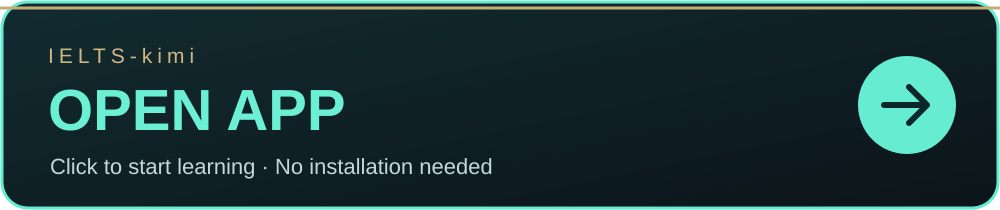

# IELTS-kimi

**Your daily English practice. Understand the roots. Make it stick.**

## [▶ Open App — 进入网站](https://kimi-minli.github.io/IELTS-kimi/)

Click **Open App** to start learning. No installation or account required.

- Kimi’s shared wordbook (11,826 entries) and IELTS Vocabulary (3,697 entries), with deduplication when both are selected
- Word origins and examples where source data is available
- American/British pronunciation and example playback
- Calendar-day spaced reviews, daily check-ins and learning records
- Personal progress saved in your own browser; backup download and restore
- Offline access after the initial site and dictionary download

Each visitor starts with a fresh learning record. There is no cloud account sync.
Clearing browser site data removes local progress; use **Settings → Download backup**.
Speech voices depend on the browser/device. Words outside the bundled IELTS dictionary
require an online lookup. Not every entry has sourced morphology or an example.

## Run locally

Serve this folder with any static web server, for example `python3 -m http.server 8000`,
then open `http://localhost:8000`. Opening index.html via file:// is not supported.

## Data and credits

See [Dictionary credits](https://kimi-minli.github.io/IELTS-kimi/sources.html).
The owner has authorized publication of Kimi’s word list. This repository does not include study history,
private backups, credentials or private repository history.
